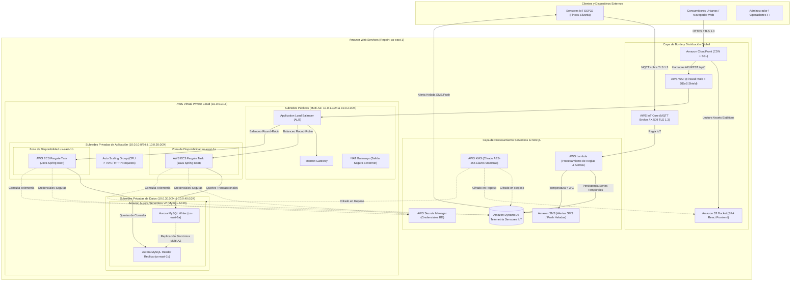
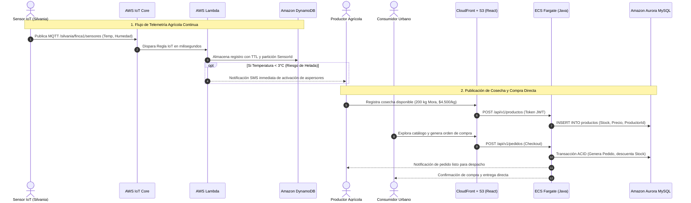

# Diagramas de Arquitectura — AgroSilvania Conectada (AWS Cloud)
**Estudiante:** Cristian Camilo Tabares Villanueva  
**Materia:** COMPUTACION EN LA NUBE / 55550 / PRIMER BLOQUE / 26P05  
**Docente:** Mario A. Reales  
**Institución:** Corporación Unificada Nacional de Educación Superior (CUN)

---

## 1. Diagrama Lógico de Red y Topología Multi-AZ (AWS VPC)

El siguiente diagrama en **Mermaid** describe la topología de red distribuida en dos Zonas de Disponibilidad (`us-east-1a` y `us-east-1b`), con tres niveles de aislamiento: Subredes Públicas (ALB e Internet Gateway), Subredes Privadas de Aplicación (AWS ECS Fargate con microservicios backend en Java) y Subredes Privadas de Datos (Amazon Aurora Serverless MySQL y Amazon DynamoDB).

---

## 2. Diagrama de Flujo de Datos: De la Finca a la Mesa

---

## 3. Modelo de Responsabilidad Compartida en AWS

```mermaid
graph TD
    subgraph ClienteResponsabilidad ["Seguridad EN la Nube (Responsabilidad de Cristian Tabares / Equipo)"]
        DataGov["Datos del Cliente y Cumplimiento Ley 1581 de 2012"]
        IAMConfig["Gestión de Identidades y Accesos (IAM con Least Privilege)"]
        AppSec["Seguridad de Microservicios Java (OWASP, Parches Spring Boot)"]
        NetConfig["Configuración de Red (Security Groups, Subredes, Tablas de Ruteo)"]
        Encryption["Cifrado de Datos en Tránsito (TLS 1.3) y en Reposo (KMS AES-256)"]
    end

    subgraph AWSResponsabilidad ["Seguridad DE la Nube (Responsabilidad de Amazon Web Services)"]
        Hardware["Servidores Físicos, Racks y Datacenters Globales"]
        Hypervisor["Virtualización, Hipervisores Nitro y Aislamiento de Cómputo"]
        Facilities["Seguridad Física, Climatización, Red Eléctrica y Detección de Fuego"]
        GlobalNet["Cables Submarinos, Regiones y Zonas de Disponibilidad (Multi-AZ)"]
    end

    DataGov --> IAMConfig --> AppSec --> NetConfig --> Encryption
    Hardware --> Hypervisor --> Facilities --> GlobalNet
```

---
*Este documento y sus diagramas en formato Mermaid pueden ser renderizados directamente en GitHub, Visual Studio Code o herramientas como Mermaid Live Editor.*
